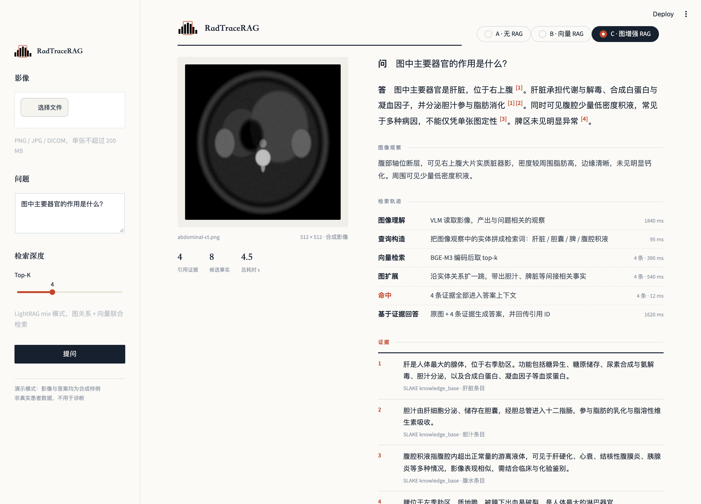
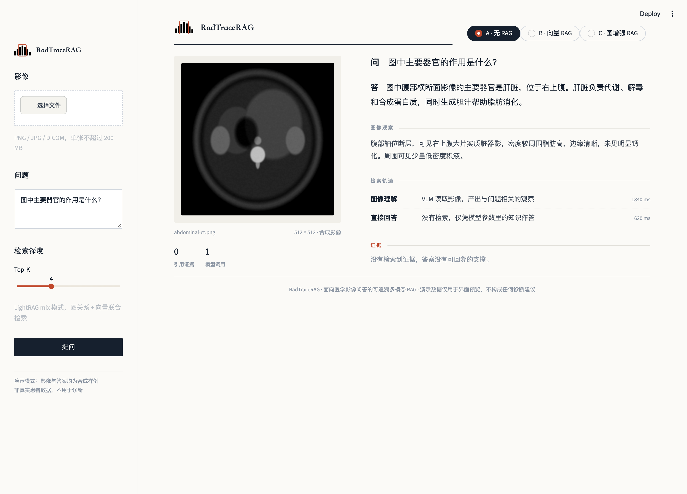
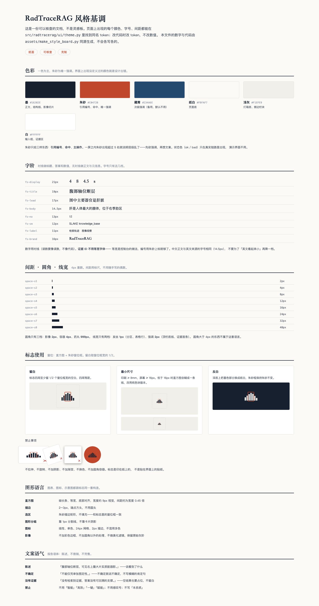

# RadTraceRAG

  

**面向医学影像问答的可追溯多模态 RAG 项目。** 通过视觉语言模型理解影像，用 [LightRAG](https://github.com/HKUDS/LightRAG) 检索相关医学知识，并将回答与证据关联起来。

RadTraceRAG 关注一个可以量化的问题：**当问题同时需要看懂影像和使用外部知识时，检索究竟有没有帮助？** 项目会在同一数据与模型设置下比较直接回答、向量检索和图增强检索，公开逐题结果、检索指标与失败案例。

> **当前阶段：项目骨架已建立。** Python 包和 LightRAG 依赖可以安装，环境检查命令可以运行；数据导入、完整问答流程与实验结果仍在开发中。下文的能力与指标是项目目标，不代表已经取得实验结果。

## 项目目标

医学影像问答中，有些问题只需要识别图像内容，例如影像模态或器官位置；另一些问题还需要外部知识，例如某个器官的功能或某种异常的相关知识。只统计总体问答准确率，很难知道系统是看懂了图像、找对了知识，还是仅凭模型记忆给出了答案。

RadTraceRAG 将这几个环节分开：

- **图像理解：**提取与当前问题相关的可见信息，而不是为整张图生成泛化描述。
- **知识检索：**从可追溯的医学知识事实中寻找证据，保留证据 ID 与排序。
- **基于证据回答：**同时使用原图和检索结果生成简短答案，显示答案所依赖的证据。
- **独立评测：**按视觉题、知识题分别统计结果，并测量检索、回答、引用和成本。

项目定位为医学影像学习与研究工具，不提供患者诊断或治疗建议。

## 工作流程

~~~mermaid
flowchart LR
    A[医学影像] --> B[视觉语言模型]
    Q[用户问题] --> B
    B --> O[与问题相关的图像观察]
    Q --> C[检索查询构造]
    O --> C
    K[SLAKE 医学知识库] --> I[LightRAG 索引]
    I --> R[证据检索与排序]
    C --> R
    A --> G[基于证据回答]
    Q --> G
    R --> G
    G --> Z[答案 · 证据 ID · 检索轨迹]
~~~

首个版本处理“**影像 + 问题 → 文本/图谱知识检索 → 回答**”。图像是输入的一部分；相似影像库检索属于后续扩展，不会被计入首个版本的成果。

### 预期交互

用户上传一张公开数据集中的影像，提问“图中主要器官的作用是什么？”。系统先记录它识别到的相关器官，再检索该器官的知识事实，最后给出答案，并允许用户查看命中的证据及其来源。若图像观察或知识证据不足，系统应明确说明无法确认的部分。

## 快速开始

项目使用 Python 3.11 和 [uv](https://docs.astral.sh/uv/) 管理环境。在项目根目录运行：

~~~bash
uv sync
uv run radtracerag doctor
~~~

<code>doctor</code> 会检查 Python 与 LightRAG 是否可导入，并显示数据和索引目录。它不下载 SLAKE，也不调用模型。完整问答命令会在数据导入和模型配置完成后加入。

当前代码按职责分为：

~~~text
src/radtracerag/
├── cli.py                 # 命令入口与环境检查
├── config.py              # 数据、索引目录配置
├── contracts.py           # 影像问题、证据和答案的数据结构
├── integrations/lightrag.py  # LightRAG 查询接入点
├── ui/                    # 演示界面（Streamlit）
├── data/                  # SLAKE 数据适配位置
└── evaluation/            # 检索与问答评测位置
~~~

## 演示界面

~~~bash
uv run radtracerag-ui
~~~

浏览器打开 http://localhost:8501 。

界面把一次问答摊开成四层：**答案 → 图像观察 + 检索轨迹 → 证据链**。
左侧常驻影像，右侧按「看到了什么、检索到了什么、结论靠哪几条证据撑着」的顺序排。
顶栏可以切换三组对照，直接看检索到底带来了什么。

排版参照的是放射科报告和学术论文：纸白底、墨色字、朱砂红做唯一强调色，
答案里的引用是上标编号，证据按 `[1] [2]` 列在下方并写明来源。
「可追溯」这件事在纸面上就是引用制度，界面照着这个来。

  

同一张片子切到「无 RAG」模式，答案没有任何证据可回溯，轨迹也只有两步：

  

> 界面目前跑的是合成样例数据，影像由程序生成，不是真实病例。
> 真实问答链路接上后，改动只在 `ui/app.py` 的 `run_question()` 一处，界面不动。
> 配色和组件规范见[界面设计规范](doc/ui-design.md)。

## 数据集

首选 [SLAKE](https://www.med-vqa.com/slake/)：它提供医学影像、问答数据、视觉标注及医学知识库，覆盖 X 光、CT、MRI 等模态。[官方数据文件](https://huggingface.co/datasets/BoKelvin/SLAKE/tree/main)包含图像、知识库和训练/验证/测试划分。项目首阶段以英文题目为正式评测对象，避免翻译差异影响答案统计。

| 数据 | 在项目中的作用 |
| --- | --- |
| 图像与问题 | 多模态输入；区分视觉题 <code>vqa</code> 和知识题 <code>kvqa</code> |
| 参考答案 | 计算问答准确率 |
| 医学知识库 | 构建 LightRAG 可检索的事实与关系 |
| 小规模人工证据标注集 | 计算证据召回率与排序指标 |

SLAKE 的参考答案可以用于问答评测，但其 <code>triple</code> 字段包含 <code>vhead</code>、<code>ktail</code> 等模板占位值，不能直接用作每道题的检索真值。因此，RadTraceRAG 会从知识题中建立一份固定的“问题 → 支持事实 ID”标注集，并公开标注规则。数据曾由发布方清洗，最终实验会记录所用版本及样本数。

## 如何评测

所有对照组使用相同的测试题、视觉模型和回答提示词，只改变是否检索以及检索方式。

| 对照组 | 证据来源 | 要回答的问题 |
| --- | --- | --- |
| **A · 无 RAG** | 仅图像和问题 | 视觉模型本身能回答到什么程度？ |
| **B · 向量 RAG** | LightRAG <code>naive</code> 模式 | 普通文本向量检索带来多少收益？ |
| **C · 图增强 RAG** | LightRAG <code>mix</code> 模式 | 图关系与向量检索结合是否进一步改善结果？ |

计划发布的指标包括：

- **检索：**人工标注集上的 Evidence Recall@k 与 MRR。
- **回答：**归一化 Exact Match；按 <code>vqa</code> / <code>kvqa</code>、开放题 / 封闭题分别报告。
- **证据：**引用是否来自实际检索结果，以及抽样检查的证据支持率。
- **效率：**p50/p95 响应时间、模型调用次数与估算成本。

测试问题、参考答案及根据它们生成的解释不会进入检索索引。图检索如果没有优于向量检索，也会在实验报告中保留这一结果和失败分析。

## 技术方案

| 组件 | 方案 |
| --- | --- |
| 语言与实验 | Python；批量评测结果保存为 JSONL/CSV |
| RAG | LightRAG Python SDK，比较 <code>naive</code> 与 <code>mix</code> 检索模式 |
| 图像理解与回答 | 可替换的视觉语言模型，首选候选为 Qwen2.5-VL-7B-Instruct |
| 向量与重排 | 首选候选为 BGE-M3；重排作为独立实验开关 |
| 演示界面 | Streamlit，展示影像、答案、证据和检索轨迹 |

项目的二次开发重点是 **SLAKE 知识库适配、图像观察到检索查询的转换、证据 ID 回传，以及逐题评测与错误分析**。具体选型和数据链路见 [技术栈文档](doc/tech-stack.md)。

## 路线图

- [x] 确定产品范围、数据集和评测协议
- [x] 建立 Python 包、LightRAG 接入点与环境检查命令
- [x] 完成演示界面：影像、答案、证据链与检索轨迹
- [ ] 固定数据版本，完成知识库导入与证据 ID 规范
- [ ] 实现无 RAG、向量 RAG、图增强 RAG 三组对照
- [ ] 发布证据标注集、评测脚本和首份实验报告
- [ ] 把演示界面接到真实问答链路上

## 视觉基调

  

纸面 · 可核查 · 克制。参照物是放射科报告和学术论文，不是控制台。
标志是「窗位」——像素值直方图加朱砂窗位框，取自医学影像本身。
完整规范见 [风格基调](doc/visual-language.md)。

## 项目文档

- [产品业务方向](doc/product-direction.md)：目标用户、使用流程、数据选择和产品边界。
- [技术栈与实现方案](doc/tech-stack.md)：模块划分、LightRAG 集成方式和评测设计。
- [风格基调](doc/visual-language.md)：色板、字阶、间距标尺、标志规范、图形语言和文案语气。
- [界面设计规范](doc/ui-design.md)：布局、分区、组件规格和实现约定。

改样式前先读 `doc/visual-language.md`：所有颜色、字号、间距都是
`src/radtracerag/ui/theme.py` 里的 token，CSS 里不写字面量。

问答流程可运行后，README 会继续补充数据准备、模型配置和批量评测命令。

## 参与项目

欢迎围绕数据标注、检索策略、实验设计和结果复现提出建议。提交实验结果时，请同时提供数据版本、模型配置、检索参数及逐题输出，以便复核结论。

开源许可证将在仓库公开发布前确定并加入。
